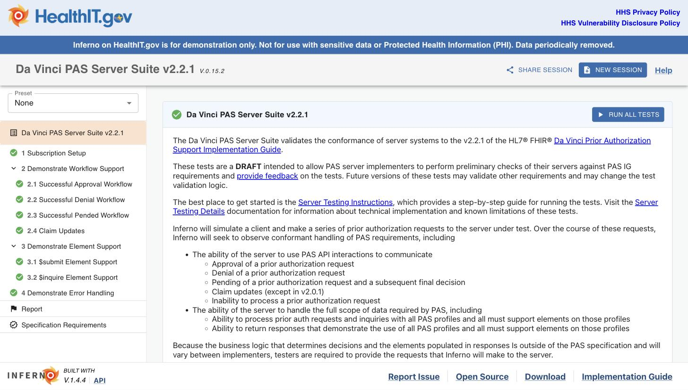
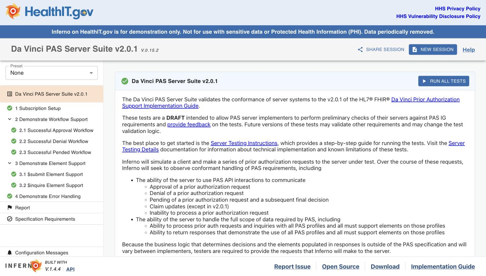
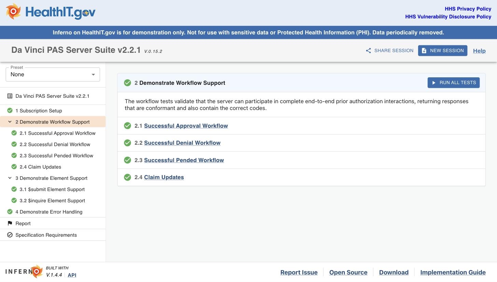
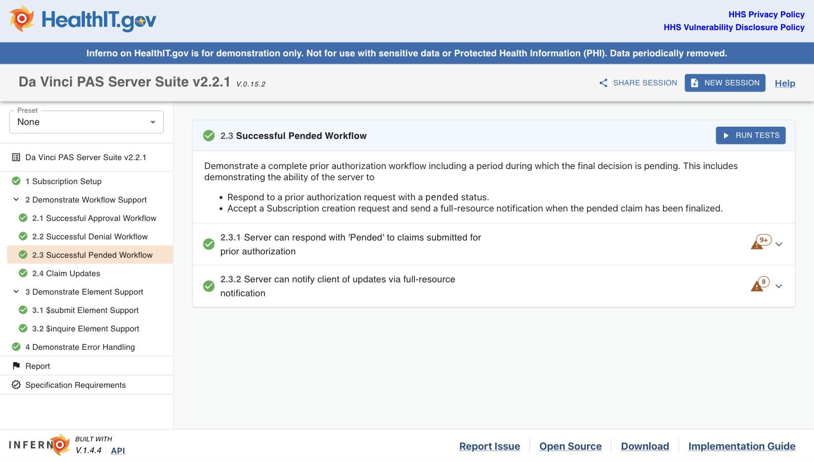
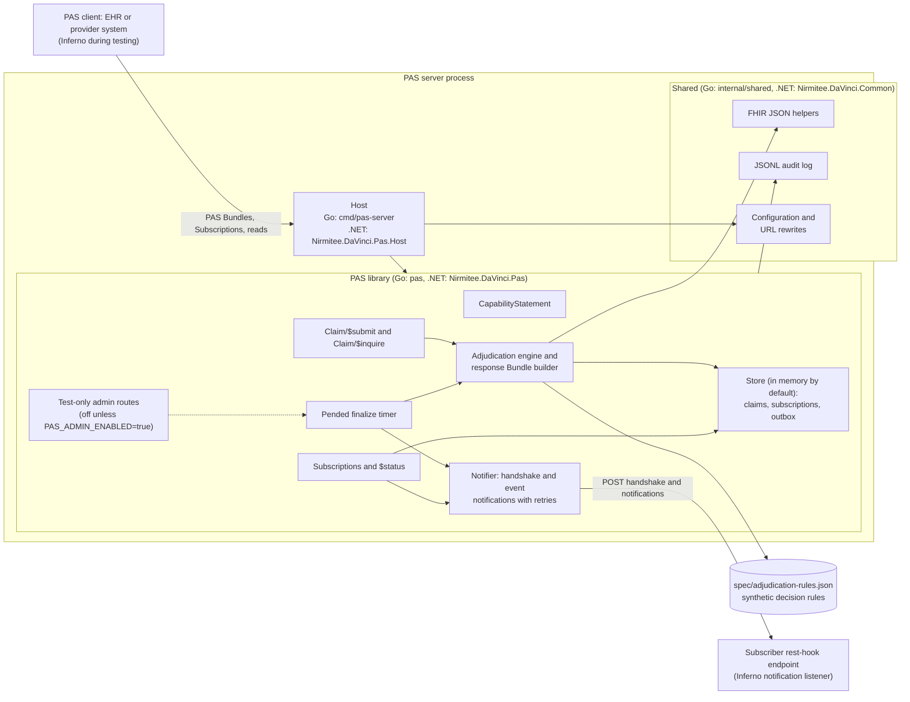
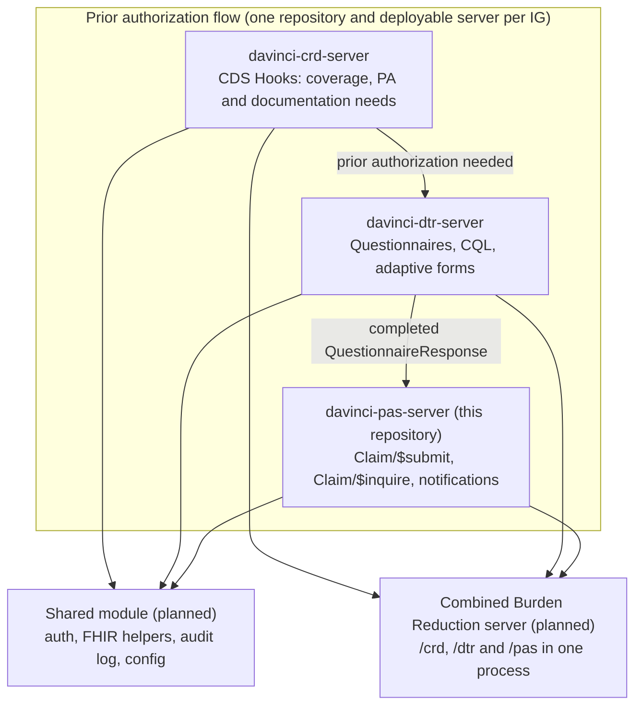

# Nirmitee Da Vinci PAS Server

[](https://github.com/Nirmitee-tech/davinci-pas-server/actions/workflows/ci.yml)
[](LICENSE)
[](https://hl7.org/fhir/us/davinci-pas/)

An open-source, payer-side implementation of the HL7 Da Vinci Prior Authorization Support (PAS) Implementation
Guide, written twice with identical behavior: once in **Go** and once in **.NET 10**. Both serve PAS 2.2.1 and PAS
STU 2.0.1 side by side and are tested against the Inferno Da Vinci PAS Server test suites. It is the sister project
of [davinci-crd-server](https://github.com/Nirmitee-tech/davinci-crd-server) and
[davinci-dtr-server](https://github.com/Nirmitee-tech/davinci-dtr-server).

## Why this exists

The CMS Interoperability and Prior Authorization Final Rule (CMS-0057-F) requires impacted payers to offer a Prior
Authorization API, with most API requirements starting in January 2027, and CMS recommends the Da Vinci Burden
Reduction implementation guides for it: CRD (Coverage Requirements Discovery), DTR (Documentation Templates and
Rules) and PAS.

PAS is the last step in that flow. Once CRD has said that prior authorization is needed and DTR has collected the
documentation, the provider system sends the request to the payer as a FHIR Bundle posted to `Claim/$submit`. The
payer answers with a ClaimResponse that carries a decision for every service line, expressed with X12 278 review
action codes:

- **A1** certified in total (approved),
- **A3** not certified (denied), with a reason code,
- **A4** pended, when the decision needs more time or more documentation,
- **A6** modified, with the substitute service the payer authorizes,
- **C** cancelled.

A pended request is finalized later. The provider system learns about it through a rest-hook Subscription on the
PAS topic: in PAS 2.2.1 the payer sends a **full-resource** notification that carries the updated response Bundle; in
STU 2.0.1 it sends an **id-only** notification, after which the client asks for the current decision with
`Claim/$inquire`. A later `$submit` with the same Claim identifier is a **claim update** that adds, changes or cancels
service lines. This repository is the payer side of PAS, meant as a working reference that payers, EHR vendors and
integrators can read, run, test against and build on.

## Inferno results

Tested with the [Inferno Da Vinci PAS Test Kit](https://github.com/inferno-framework/davinci-pas-test-kit) v0.15.2
on 12 September 2026, suites `davinci_pas_server_suite_v221` (PAS 2.2.1) and `davinci_pas_server_suite_v201` (PAS
STU 2.0.1). Report summaries are in [docs/results/](docs/results/).

| Implementation | Suite | Run | Pass | Fail | Skip | Report |
|---|---|---|---|---|---|---|
| Go | PAS v2.2.1 | local, HTTP | 84 of 84 | 0 | 0 | [summary](docs/results/20260912T082955Z_go-local_v221.md) |
| .NET | PAS v2.2.1 | local, HTTP | 84 of 84 | 0 | 0 | [summary](docs/results/20260912T083049Z_dotnet-local_v221.md) |
| Go | PAS v2.0.1 | local, HTTP | 68 of 68 | 0 | 0 | [summary](docs/results/20260912T082955Z_go-local_v201.md) |
| .NET | PAS v2.0.1 | local, HTTP | 68 of 68 | 0 | 0 | [summary](docs/results/20260912T083049Z_dotnet-local_v201.md) |
| Go | PAS v2.2.1 | public inferno.healthit.gov, HTTPS | 84 of 84 | 0 | 0 | [session](https://inferno.healthit.gov/suites/davinci_pas_server_suite_v221/2J5K5V4S2GP), [summary](docs/results/20260912T083140Z_go-public_v221.md) |
| Go | PAS v2.0.1 | public inferno.healthit.gov, HTTPS | 68 of 68 | 0 | 0 | [session](https://inferno.healthit.gov/suites/davinci_pas_server_suite_v201/5sExZQ10qCl), [summary](docs/results/20260912T083140Z_go-public_v201.md) |
| .NET | PAS v2.2.1 | public inferno.healthit.gov, HTTPS | 84 of 84 | 0 | 0 | [session](https://inferno.healthit.gov/suites/davinci_pas_server_suite_v221/jYn573TH9qT), [summary](docs/results/20260912T083524Z_dotnet-public_v221.md) |
| .NET | PAS v2.0.1 | public inferno.healthit.gov, HTTPS | 68 of 68 | 0 | 0 | [session](https://inferno.healthit.gov/suites/davinci_pas_server_suite_v201/m7Nz1Mr9kR), [summary](docs/results/20260912T083524Z_dotnet-public_v201.md) |

Every test in every group passes locally: Subscription Setup, Demonstrate Workflow Support (approval, denial, pended
with notification, and on v2.2.1 claim updates), Demonstrate Element Support and Demonstrate Error Handling. There are
no failures, errors or skips. The PAS server suites contain no TLS test, so the public runs repeat the same tests on
the hosted Inferno instance, with the server reached through an HTTPS tunnel. Passing Inferno is a conformance signal,
not a certification.

### Screenshots from the public Inferno sessions

Captured on inferno.healthit.gov (PAS test kit v0.15.2) from the public sessions linked in the table above. Every
group is green in all four sessions.

**Suite overview**

| Go | .NET |
|---|---|
|  |  |
|  |  |

**v2.2.1 Demonstrate Workflow Support: approval, denial, pended with notification, and claim updates**



**v2.2.1 Successful Pended Workflow: the pended wait resumed by the server's notification**

The triangle badges count validator messages attached to each test (warnings and information); both tests pass.



### Test kit notes

No known Inferno kit defect blocks PAS: [harness/known_kit_issues.json](harness/known_kit_issues.json) has no entries,
and a conformant server can pass every test. Two kit behaviors would cause avoidable failures and are handled as
recorded in [spec/SPEC.md](spec/SPEC.md) section 17:

- **US Core version pinning.** The kit validates every US Core profile declared in a request Bundle as
  `<profile>|6.1.0`, in both suites. `us-core-condition` does not exist in US Core 6.1.0, so a v2.0.1 Condition that
  declares it ends in a validator error ("Unable to resolve profile us-core-condition|6.1.0"). The v2.0.1 test data
  Condition therefore declares no US Core profile.
- **Validator suppressions inside notifications.** The kit suppresses validator errors caused by extension context
  defects in the PAS IG, but its suppressions are anchored to top-level element paths, so they do not apply to the
  ClaimResponse nested inside a v2.2.1 full-resource notification. The ClaimResponse copy in the notification omits
  those extensions (root `itemAuthorizedProvider`, `item` `communicatedDiagnosis`, and four `addItem` extensions),
  while the `$submit` and `$inquire` responses keep them. Must support coverage is not affected.

The harness also works around two behaviors of the Inferno JSON API that are not test failures: an incoming
handshake is not exposed on the waiting result, and the public instance lists the pended wait only at group level.

## Features

- **Two PAS versions in one process**: PAS 2.2.1 under `/v221/fhir` and STU 2.0.1 under `/v201/fhir`, each with its
  own CapabilityStatement declaring `Claim/$submit`, `Claim/$inquire`, ClaimResponse read and Subscription create,
  read, update and delete on the PAS topic.
- **`Claim/$submit`**: structural checks answer 400 with an OperationOutcome (not a collection Bundle, no entries,
  first entry not a Claim, unresolvable patient, insurer or provider, no items). Every item is adjudicated by
  deterministic rules, and the PAS Response Bundle holds the ClaimResponse first, then every resource it references,
  copied verbatim from the request exactly once. The submitted Claim is never echoed. Business problems go into
  `ClaimResponse.error` with X12 error and follow-up action codes.
- **Decisions with X12 278 codes**: `extension-reviewAction` on `ClaimResponse.item.adjudication` with review action
  codes A1, A3, A4, A6 and C, authorization numbers for certified items, denial reason codes, an `addItem` with the
  authorized substitute for modified items, and a CommunicationRequest and Task when documentation is needed.
- **Pended claims and notifications**: rest-hook Subscriptions with a handshake about one second after the 201,
  `Subscription/{id}/$status`, and finalization of pended items after `PAS_PENDED_AUTO_FINALIZE_SECONDS`. Each active
  Subscription whose `org-identifier` filter matches the requesting organization gets one event notification:
  full-resource with the updated response Bundle on v2.2.1, id-only with the `ClaimResponse` URL on v2.0.1 (served by
  `GET ClaimResponse/{id}`). Delivery retries while the answer is not 2xx, never resends after a 2xx and sends no
  heartbeats.
- **`Claim/$inquire`**: answers from the stored submission and adjudicates unknown items with the same rules, maps
  replaced authorization numbers, and returns `Parameters` with a `return` Bundle on v2.2.1 and the Bundle itself on
  v2.0.1.
- **Claim updates**: a submit with an existing Claim identifier replaces the stored request, is adjudicated again and
  returns exactly the submitted item sequences, including cancelled items.
- **Optional bearer authentication** through `PAS_AUTH_TOKENS`. There are no default credentials; `GET metadata`
  never needs a token.
- **External base URL** from `PAS_PUBLIC_BASE_URL` or the incoming request, so Subscription references and `$status`
  URLs in notifications stay correct behind proxies and tunnels.
- **Audit log**: one JSON line per request, response and notification attempt in a daily file, with bearer tokens
  redacted, including those inside `Subscription.channel.header`.
- **Rules as data**: [spec/adjudication-rules.json](spec/adjudication-rules.json) holds the synthetic decision rules
  both servers load unchanged. They are test rules, not coverage policy.
- **Reference model and golden examples**: `spec/reference/pas_reference.py` is an executable reading of the spec.
  It replays the test data in suite order, writes the golden exchanges in `spec/examples/` and runs offline checks
  that mirror the kit's must support, structure, decision, update, inquiry and notification logic. The Go and .NET
  unit tests replay the same test data through their HTTP handlers.
- **Library plus host**: no global state, a configurable route prefix and pluggable storage interfaces (in memory by
  default), so the PAS module can be mounted next to CRD and DTR in one process. Docker images run as a non-root user.
- **Test-only admin routes, off by default**, so an automated Inferno run can finish without a human. See
  [Test-only admin routes](#test-only-admin-routes).

## Architecture

Each implementation is a PAS library, a shared package for cross-cutting concerns and a thin host.



The Go `internal/shared` package and the .NET `Nirmitee.DaVinci.Common` project are copies of the ones in the DTR
server with the same public API. That keeps the servers independent today and makes the shared module a mechanical
extraction later.

How PAS fits with the CRD and DTR servers:



Mounting the PAS module in your own host:

```go
cfg, err := pas.LoadConfig(os.Getenv)
if err != nil { log.Fatal(err) }
cfg.Prefix = "/pas"
handler, err := pas.NewHandler(cfg)
if err != nil { log.Fatal(err) }
if c, ok := handler.(io.Closer); ok { defer c.Close() } // stops finalize timers and pending deliveries
mux.Handle("/pas/", handler) // /pas/v221/fhir, /pas/v201/fhir, /pas/health
```

```csharp
builder.Services.AddPas(builder.Configuration);
app.MapPas("/pas");   // /pas/v221/fhir/..., /pas/v201/fhir/..., /pas/health
```

The full behavior contract both implementations follow is [spec/SPEC.md](spec/SPEC.md). Implementation details are
in [go/README.md](go/README.md) and [dotnet/README.md](dotnet/README.md).

## Quick start

```sh
git clone https://github.com/Nirmitee-tech/davinci-pas-server.git
cd davinci-pas-server
```

### Go (native)

Requires Go 1.26.

```sh
cd go
go run ./cmd/pas-server
curl http://localhost:8085/v221/fhir/metadata
```

### .NET (native)

Requires the .NET 10 SDK.

```sh
cd dotnet
dotnet run --project src/Nirmitee.DaVinci.Pas.Host
curl http://localhost:8086/v221/fhir/metadata
```

### Docker

The Go image builds from `go/` (the rules are bundled in the binary); the .NET image builds from the repository root
(the build embeds `spec/adjudication-rules.json`).

```sh
docker build -t davinci-pas-server-go go/
docker run --rm -p 8085:8085 davinci-pas-server-go

docker build -f dotnet/Dockerfile -t davinci-pas-server-dotnet .
docker run --rm -p 8086:8086 davinci-pas-server-dotnet
```

Inside a container `http://localhost` is the container itself. When a subscriber on the host gives a `localhost`
notification endpoint (as a local Inferno on port 8280 does), rewrite it:
`-e PAS_URL_REWRITES="http://localhost:8280|http://host.docker.internal:8280"` for Go, or
`-e Pas__NotificationUrlRewrites__0__From=http://localhost:8280 -e Pas__NotificationUrlRewrites__0__To=http://host.docker.internal:8280`
for .NET.

### A first prior authorization request

Authentication is off until `PAS_AUTH_TOKENS` is set, so a local server accepts the synthetic request Bundles
directly. From the repository root:

```sh
curl -s -X POST 'http://localhost:8085/v221/fhir/Claim/$submit' \
  -H 'Content-Type: application/fhir+json' \
  --data @testdata/v221/approval_submit.json
```

The response is a PAS Response Bundle whose ClaimResponse item carries review action code `A1`. To see a pended
decision being finalized, submit the v2.0.1 pended request, wait for the auto finalize delay (10 seconds by default)
and inquire:

```sh
curl -s -X POST 'http://localhost:8085/v201/fhir/Claim/$submit' \
  -H 'Content-Type: application/fhir+json' --data @testdata/v201/pended_submit.json   # A4
sleep 11
curl -s -X POST 'http://localhost:8085/v201/fhir/Claim/$inquire' \
  -H 'Content-Type: application/fhir+json' --data @testdata/v201/pended_inquire.json  # A1
```

Use port 8086 for the .NET server.

## Configuration

Environment variables shared by both implementations:

| Variable | Default | Meaning |
|---|---|---|
| `PAS_PORT` | `8085` (Go), `8086` (.NET) | listen port on all interfaces |
| `PAS_PREFIX` | empty | route prefix, for example `/pas` |
| `PAS_PUBLIC_BASE_URL` | unset | fixed external origin used in notifications and resource URLs, for example `https://<tunnel-host>` |
| `PAS_RULES_FILE` | Go: `spec/adjudication-rules.json`, then `../spec/adjudication-rules.json`, then the bundled copy; .NET: the embedded copy | adjudication rules file |
| `PAS_AUTH_TOKENS` | empty | accepted bearer tokens, comma separated; empty disables authentication |
| `PAS_PENDED_AUTO_FINALIZE_SECONDS` | `10` | delay before auto-finalizable pended items are decided; `0` disables it |
| `PAS_NOTIFICATION_RETRY_SECONDS` | `3` | retry interval for handshake and event notifications |
| `PAS_NOTIFICATION_MAX_SECONDS` | `280` | stop retrying a notification after this long |
| `PAS_ADMIN_ENABLED` | unset (disabled) | test-only admin routes; only the exact value `true` enables them |
| `PAS_DATA_DIR` | `data` (Go), `./data` (.NET) | audit log root: `{dir}/audit/` (Go), `{dir}/pas-audit/` (.NET), one `YYYY-MM-DD.jsonl` file per day |

Implementation-specific settings:

| Setting | Go | .NET |
|---|---|---|
| Listen address | `PAS_LISTEN` or `-listen` | `--urls` or `ASPNETCORE_URLS` |
| Config file | `PAS_CONFIG_FILE` (YAML or JSON) | `appsettings.json`, `Pas` section, or `Pas__*` variables |
| Notification endpoint rewrites | `PAS_URL_REWRITES` (`from\|to` pairs) | `Pas__NotificationUrlRewrites__N__From`, `__To` |
| Handshake delay | config file `handshakeDelay` | `Pas__HandshakeDelaySeconds` |
| Log level | `PAS_LOG_LEVEL` | `Logging__LogLevel__Default` |

State is held in memory and is cleared on restart. Both Docker images set `PAS_DATA_DIR=/data` and neither sets
`PAS_ADMIN_ENABLED`.

## Test-only admin routes

Three control routes exist only so an automated Inferno run can proceed without a human:

| Route | What it does when enabled |
|---|---|
| `GET {prefix}/admin/notifications` | delivery log of handshakes and event notifications, including the bearer token sent to each notification endpoint |
| `POST {prefix}/admin/pended/finalize` | decides every auto-finalizable pended item now and queues the notifications |
| `POST {prefix}/admin/reset` | clears all claims, Subscriptions and queued notifications |

Because they reveal notification tokens, let the caller decide pended claims and wipe state, they are guarded as
described in [spec/SPEC.md](spec/SPEC.md) section 11:

- **Disabled by default.** Every `/admin/*` path answers 404 with an OperationOutcome, exactly like an unknown route,
  so a deployment does not reveal that they exist.
- **Enabled only by `PAS_ADMIN_ENABLED=true`.** Any other value, or no value, keeps them disabled.
- **Blocked through proxies and tunnels.** Even when enabled, a request that carries `X-Forwarded-For` or `Forwarded`
  is refused with 403. The harness calls them directly on the server host.
- **Never enable them on a reachable production server.** Set the flag only for the duration of an Inferno run and
  restart without it afterwards. Published images and production configurations must not set it.

`GET {prefix}/health` is not an admin route and is always available. Without the flag an Inferno run still completes,
more slowly: the harness waits a grace period at the handshake and relies on auto finalize at the pended wait.

## Running the Inferno suites yourself

The test kit is not part of this repository. You need Docker with Compose 2.24.4 or newer, and Python 3.

```sh
# 1. clone the Inferno PAS test kit in the repository root (the folder is gitignored)
git clone https://github.com/inferno-framework/davinci-pas-test-kit.git

# 2. add davinci-pas-test-kit/docker-compose.override.yml (below), then start the kit on port 8280
(cd davinci-pas-test-kit && COMPOSE_PROJECT_NAME=inferno-pas sh setup.sh && docker compose -p inferno-pas up -d)

# 3. start a server natively for the run, with the admin routes enabled (Go on 8085)
(cd go && PAS_ADMIN_ENABLED=true go run ./cmd/pas-server)

# 4. in another terminal, run both suites
python3 harness/run_suite.py --suite both --label go-local
```

For .NET, start `PAS_ADMIN_ENABLED=true dotnet run --project dotnet/src/Nirmitee.DaVinci.Pas.Host` and run:

```sh
python3 harness/run_suite.py --suite both --label dotnet-local \
  --fhir-base "http://host.docker.internal:8086/{suite}/fhir" --control-url http://localhost:8086
```

The override publishes Inferno on `http://localhost:8280`, lets the Inferno containers reach servers on the host
through `host.docker.internal`, keeps Redis and FHIRPath unpublished and gives the HL7 validator enough memory:

```yaml
name: inferno-pas
services:
  inferno:
    environment:
      INFERNO_HOST: http://localhost:8280
    extra_hosts:
      - "host.docker.internal:host-gateway"
  worker:
    environment:
      INFERNO_HOST: http://localhost:8280
    extra_hosts:
      - "host.docker.internal:host-gateway"
  hl7_validator_service:
    mem_limit: 6g
    environment:
      JAVA_TOOL_OPTIONS: -Xmx5g
  fhirpath:
    ports: !reset []
  redis:
    ports: !reset []
  nginx:
    ports: !override
      - "8280:80"
```

The harness creates the session, fills the inputs from `testdata/v221` or `testdata/v201` and runs the groups in
order. It handles both waits: at Subscription Setup it confirms the handshake once the server has delivered it, and
at the pended workflow it calls `POST /admin/pended/finalize` so the server's event notification resumes Inferno.
Useful options: `--groups 1,2`, `--dry-run` (print the resolved inputs), `--bearer-token` (when `PAS_AUTH_TOKENS` is
set), `--no-trigger` (rely on auto finalize) and `--notification-timeout`. Reports are written to
`harness/reports/<UTC>_<label>_<suite>/`. The exit status is 0 when every test passed, 1 on failures (skips count as
failures unless `--allow-skips`), 2 for a setup problem and 3 when the only failures are entries in
`harness/known_kit_issues.json`. Call `POST /admin/reset` between runs, because Subscriptions from earlier sessions
also receive notifications.

Offline checks that need no Inferno: `python3 spec/reference/pas_reference.py` (replays both suites against the
reference model), `python3 harness/stubs/selftest.py` (harness self test) and `python3 testdata/build_testdata.py`
(regenerates the test data).

To run on the public Inferno instance, expose the server over HTTPS, for example with `ngrok http 8085`, start it
with `PAS_ADMIN_ENABLED=true PAS_PUBLIC_BASE_URL=https://<ngrok-host>`, and run the harness with
`--inferno https://inferno.healthit.gov/suites --fhir-base "https://<ngrok-host>/{suite}/fhir" --control-url http://localhost:8085`.
The admin routes still answer 403 through the tunnel; the harness calls them on localhost. Stop the tunnel and restart
the server without the flag when the run ends. The step-by-step guide is
[harness/tls_public_run.md](harness/tls_public_run.md).

## Repository layout

```
go/             Go implementation: pas/ library, cmd/pas-server host, internal/shared
dotnet/         .NET 10 implementation: Nirmitee.DaVinci.Pas library, Pas.Host, Common, xUnit tests
spec/           SPEC.md behavior contract, adjudication-rules.json, examples/ golden exchanges,
                ms-metadata/ must support lists, reference/ reference model, tools/ offline checks
testdata/       synthetic Inferno inputs for the v2.2.1 and v2.0.1 suites and their generator
harness/        suite runner, reference server, stubs and self test, known kit issues, public run guide
docs/results/   curated Inferno report summaries
```

## Roadmap

- **Shared module**: replace the copies of the shared code in the CRD, DTR and PAS servers with one module for
  authorization, FHIR helpers, the audit log and configuration.
- **Combined server**: one Burden Reduction host that mounts CRD, DTR and PAS under their own prefixes.
- **Test kit updates**: rerun the suites on new Inferno PAS test kit releases and record any change in
  `spec/SPEC.md`.

## Contributing

Contributions are welcome. Behavior changes start in `spec/SPEC.md` and land in both implementations. See
[CONTRIBUTING.md](CONTRIBUTING.md) for setup, tests and the pull request checklist, and follow the
[Code of Conduct](CODE_OF_CONDUCT.md). Report security issues privately as described in [SECURITY.md](SECURITY.md).

All data in this repository is synthetic. Please never post real patient data in issues or pull requests.

## License

Apache License 2.0. See [LICENSE](LICENSE) and [NOTICE](NOTICE).

HL7, FHIR and the FHIR [FLAME DESIGN] are the registered trademarks of Health Level Seven International and their use
does not constitute endorsement by HL7. The Inferno test kit is developed by the Inferno Framework team and is not
redistributed here.

Built by [Nirmitee.io](https://nirmitee.io/healthcare-interoperability/).
